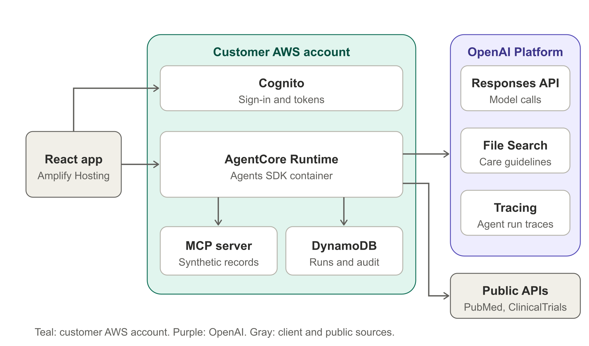

# Tumor board case prep demo

A demonstration of how the OpenAI Platform (Responses API, Agents SDK, File Search, MCP) can help a breast
oncology team prepare a case for tumor board. All patient data and guideline documents are synthetic. This is a
demonstration, not a medical device, and it does not give treatment advice.

## What it does
A manager agent asks three specialists (patient data, clinical history, evidence) for sourced findings, drafts a
structured packet, has a separate verifier agent check it, then pauses for a clinician to approve or request
changes. Nothing is written to a patient record.

The synthetic case has planted problems the agents should catch: a note that says HER2-positive while the signed
pathology says HER2-negative, a prior blood clot that matters for tamoxifen, an old bone density scan, missing
genetic testing, and a superseded pathway document that should not be used.

## What the UI shows
A patient banner and case timeline, a live feed of what each agent is doing, a board summary with attention chips,
conflicts between sources, options with patient facts and pathway text kept apart, a source viewer behind every
citation, the verifier findings, a clinician review step (approve or request changes), an audit trail, run stats with
a link to the OpenAI trace, and a printable board brief.

## Results
- `docs/eval-results.md`: ten runs of the synthetic case. Six checks on the planted problems passed in all ten runs.
  Average 88 seconds of agent work and about $0.10 of model cost per case at list prices.
- `docs/sample-packet.json`: a real packet produced by the agents.
- `docs/value-model.xlsx`: editable assumptions for the time saved. These are assumptions, not measurements.

## Layout
- `agent/` agent code (TypeScript, OpenAI Agents SDK) and the HTTP server that runs on AgentCore Runtime
- `mcp-server/` the mock patient record, exposed as an MCP server
- `web/` React app (Amplify libraries for sign-in)
- `infra/` AWS CDK stack: Cognito, DynamoDB, the MCP Lambda, the AgentCore Runtime
- `data/` synthetic case files and synthetic institutional pathway documents
- `deck/` slide deck source and the built deck
- `docs/` architecture diagram, value model, and the recording script
- `scripts/` helper scripts

Run the evaluation with `cd agent && npm run eval` (needs the local setup below).

## Run locally
1. `cp agent/.env.example agent/.env` and fill in `OPENAI_API_KEY` (this file is git-ignored).
2. Start the mock record server: `cd mcp-server && npm i && MCP_TOKEN=local-dev-token npm run dev`
3. Index the pathway documents: `cd agent && npm i && npm run seed`. Copy the printed `VECTOR_STORE_ID` into `.env`.
4. Terminal run: `npm run cli`. Or run the server with `npx tsx --env-file=.env src/server.ts` and the UI with
   `cd web && npm i && VITE_AUTH=off VITE_AGENT_URL=http://localhost:8080/invocations npm run dev`.

## Deploy to AWS
1. Put the OpenAI key in Secrets Manager: `./scripts/create-secret.sh` (reads `agent/.env`, prints nothing).
2. `cd infra && npm i && npx cdk bootstrap && npx cdk deploy -c vectorStoreId=<your vector store id>`
3. Create a sign-in user: `./scripts/create-demo-user.sh` (prints a random password once).
4. Build the UI with the stack outputs as `VITE_USER_POOL_ID`, `VITE_USER_POOL_CLIENT_ID`, `VITE_AGENT_ARN`
   (see `web/.env.example`) and upload `web/dist` to an Amplify Hosting app.

## Clean up
- `cd infra && npx cdk destroy`
- Delete the secret `case-prep-demo/secrets` in Secrets Manager
- Delete the Amplify Hosting app
- Delete the OpenAI vector store and the budget `case-prep-demo-monthly` if you no longer need them

## Notes
- The mock record server's function URL is public but requires a bearer token. It holds only synthetic data.
- Reasoning effort and model are set with `REASONING_EFFORT` and `OPENAI_MODEL`.
- The pathway documents are invented for this demo. They are not clinical guidance.
